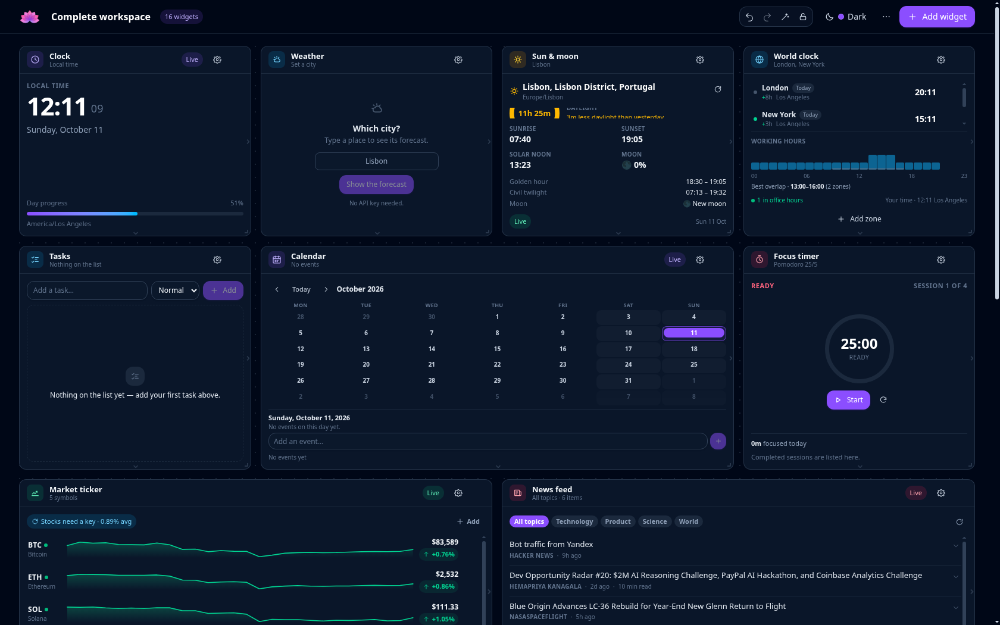
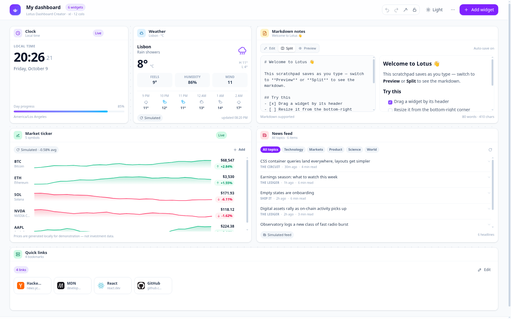
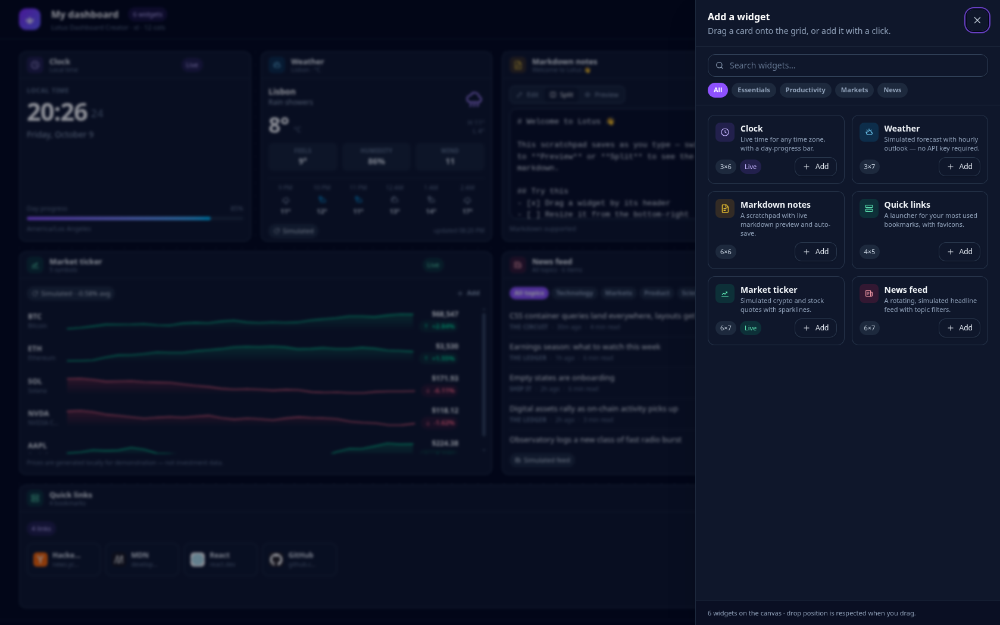

# Lotus Dashboard Creator

A modular, drag-and-drop dashboard builder for the browser. Arrange, resize and
persist your own workspace of widgets — live clock, weather, markdown scratchpad,
quick links, market ticker and a news feed — with a plugin architecture that
makes adding a seventh widget a single file.

Built with **Vite 8 · React 19 · TypeScript (strict) · Tailwind CSS 4 · Zustand 5
· react-grid-layout 2**.



<p align="center">
  
  
</p>

---

## Table of contents

- [Features](#features)
- [Quick start](#quick-start)
- [Project structure](#project-structure)
- [Architecture](#architecture)
- [Writing your own widget](#writing-your-own-widget)
- [Keyboard shortcuts](#keyboard-shortcuts)
- [The layout JSON format](#the-layout-json-format)
- [Testing & verification](#testing--verification)
- [Performance notes](#performance-notes)
- [Accessibility](#accessibility)
- [Notes & limitations](#notes--limitations)
- [License](#license)

## Features

**Canvas & layout engine**

- Responsive 12-column grid (5 breakpoints: `xl lg md sm xs`) with drag, resize
  and collision-aware compaction.
- Layout for **every** breakpoint is stored, so a phone layout and a desktop
  layout never fight each other.
- Live snap placeholder while dragging, resize handles on the south, east and
  south-east edges, and a **drag a card straight out of the gallery onto the
  grid** drop flow (mouse _and_ touch).
- Lock the layout to stop accidental drags, or hit **Tidy up** to close every
  gap.
- Add, duplicate, rename, reconfigure and remove individual widgets.

**Persistence & portability**

- Automatic `localStorage` persistence (debounced by zustand's `persist`
  middleware) — the dashboard is exactly as you left it after a reload, including
  the theme.
- **Export** the whole workspace as a self-describing JSON file, import it back
  from the file picker *or* by dropping the file onto the canvas, with a preview
  of what will change before anything is replaced.
- Undo/redo (`⌘/Ctrl + Z`) for every structural change: adding, removing,
  duplicating, dragging, resizing, tidying, applying templates, importing and
  resetting. Rapid edits are coalesced into a single history step.
- Four starter templates, plus a one-click reset to the default workspace.

**Widgets**

| Widget | Highlights |
| --- | --- |
| **Clock** | Live time in any IANA time zone, 12/24h, optional seconds, day-progress bar. |
| **Weather** | Live forecast from wttr.in (no API key) with hourly outlook and details, falling back to a locally simulated forecast offline. |
| **Markdown notes** | Multi-note editor with a left file panel (create, switch, delete with confirmation), draggable dividers between the panel and both panes, auto-save with edit / split / preview modes and a dependency-free markdown renderer. |
| **Quick links** | Bookmark launcher with favicons (graceful initial-chip fallback), inline add/edit/remove, and drag — or ↑/↓ — to reorder. |
| **Market ticker** | Live crypto quotes (CoinGecko, keyless) and live stock quotes (Finnhub, your own free key) with sparklines and per-symbol add/remove. |
| **News feed** | Live headlines from four keyless, CORS-enabled providers (Hacker News, DEV Community, Spaceflight News, Wikipedia's current-events desk) with topic filters, source links and expandable summaries; falls back to a labelled simulated feed offline. |

**Polish**

- Dark / light / system theme with no flash of the wrong colour scheme on load.
- Toast notifications with undo actions, per-widget error boundaries, an empty
  state that explains what to do next, and a keyboard shortcut cheat sheet.
- Zero console errors or warnings — verified in a real browser (see
  [Testing & verification](#testing--verification)).

## Quick start

Requirements: **Node.js `^20.19` or `>=22.12`** and npm (or pnpm/yarn — the
lockfile is npm's).

```bash
# 1. install
npm install

# 2. start the dev server (http://localhost:5173)
npm run dev
```

Other scripts:

| Script | What it does |
| --- | --- |
| `npm run dev` | Vite dev server with HMR. |
| `npm run build` | Type-checks (`tsc --noEmit`) and builds to `dist/`. |
| `npm run build:single` | Type-checks and builds the portable **one-file** dashboard to `dist-single/index.html`. |
| `npm run preview` | Serves the production build on http://localhost:4173. |
| `npm run typecheck` | TypeScript only. |
| `npm run lint` | ESLint (flat config, TypeScript + React hooks rules). |
| `npm test` | Vitest unit suite (174 tests). |
| `npm run test:watch` | Vitest in watch mode. |
| `npm run verify` | typecheck → lint → test → build → build:single. |
| `npm run verify:browser` | Builds the one-file dashboard and drives it in a real Chrome (add `-- --dev` to also check a running server). |

The app is entirely client-side: no backend, and no API key needed for anything
except stock prices. Network calls happen in four places, and each degrades
gracefully: the weather widget uses [wttr.in](https://wttr.in) and falls back to
a simulated forecast, the market ticker prices crypto through
[CoinGecko](https://www.coingecko.com/en/api) (keyless) and falls back to
simulated crypto, the news feed reads four keyless providers and falls back to a
simulated feed labelled **Simulated**, and the quick-links favicon lookup falls
back to an initials chip. Stock quotes are the one thing that needs a key, from
[Finnhub](https://finnhub.io/register) — a free key the user pastes into the
widget's settings. Stock prices are **never simulated** — without a key they are
shown as unavailable with a sign-up link (see the notes below).

## Project structure

```
scripts/
├── build-single-file.mjs       # inlines script/style/images into one HTML file
├── verify-browser.mjs          # real-Chrome checks for what unit tests cannot reach
└── browser/                    # dependency-free CDP client + the checks themselves

src/
├── App.tsx                     # shell: toolbar + canvas + status bar + overlays
├── main.tsx                    # React root, global CSS imports
├── assets/                     # logo + icons, imported so they can be inlined
├── components/
│   ├── feedback/               # ErrorBoundary, StorageNotice, ToastViewport
│   ├── forms/SettingsForm.tsx  # schema-driven settings renderer
│   ├── icons.tsx               # ~35 inline SVG icons
│   ├── layout/                 # HeaderBar, StatusBar, DashboardCanvas,
│   │                           # WidgetFrame, ImportDropZone
│   ├── modals/                 # AddWidgetDrawer, WidgetSettingsModal,
│   │                           # TemplatesDialog, ImportDialog, ShortcutsDialog…
│   └── ui/                     # Button, Modal, Drawer, Dropdown, Field, Markdown…
├── constants/                  # app + grid constants (breakpoints, row height…)
├── hooks/                      # useInterval, useNow, useWeather, useNews, useDebouncedValue,
│                               # useSaveDashboardFile, useHotkeys, useTheme, useFocusTrap…
├── lib/
│   ├── grid.ts                 # pure layout maths (placement, packing, diffing)
│   ├── markdown.ts             # tokenising markdown parser
│   ├── validation.ts           # import/export validation & normalisation
│   ├── document.ts             # dashboard document building/serialising
│   ├── templates.ts            # starter templates
│   ├── storage.ts              # safe localStorage adapter (memory fallback)
│   ├── storageKeys.ts          # per-document key scoping on file://
│   ├── embedded.ts             # the snapshot carried inside a saved HTML file
│   ├── singleFile.ts           # serialising the running app to one file
│   ├── fileHandle.ts           # File System Access + remembered file handle
│   ├── weather.ts              # live wttr.in provider (fetch + condition mapping)
│   ├── market.ts               # live providers: CoinGecko (crypto) + Finnhub (stocks)
│   ├── news.ts                 # live providers: HN, DEV, Spaceflight News, Wikipedia
│   ├── notes.ts                # notes model: migration, titles, add/update/remove
│   ├── mock/                   # deterministic weather / market / news providers
│   └── utils.ts                # cn(), formatting, ids, download helpers…
├── store/
│   ├── dashboardStore.ts       # workspace, layouts, history, persistence
│   ├── prefsStore.ts           # theme, preferences + optional Finnhub key
│   ├── toastStore.ts           # notifications
│   └── uiStore.ts              # which overlay is open, drag payload
├── styles/index.css            # Tailwind v4 theme, animations, grid theming
├── types/                      # layout.ts, widget.ts, dashboard.ts
├── widgets/
│   ├── define.ts               # plugin authoring helper (typed boundary)
│   ├── factory.ts              # instance factory
│   ├── registry.ts             # the widget registry (single source of truth)
│   ├── shared/                 # Sparkline, DeltaPill, WeatherGlyph
│   ├── clock/ weather/ notes/ links/ market/ news/
└── test/setup.ts               # in-memory localStorage for the unit suite
```

## Architecture

### State: four small stores, one direction of data

| Store | Responsibility | Persisted |
| --- | --- | --- |
| `dashboardStore` | Dashboard title, widget instances, per-breakpoint layouts, lock flag, undo/redo | ✅ `localStorage` |
| `prefsStore` | Theme mode, grid hints, delete confirmation, optional Finnhub key | ✅ `localStorage` |
| `uiStore` | Open overlay, settings target, pending import, drag payload | ❌ |
| `toastStore` | Transient notifications | ❌ |

The canvas is a *controlled* grid: the store owns the layout, `react-grid-layout`
reports changes through `onLayoutChange`, and the store normalises and persists
them. Widgets never import the dashboard store — they receive `config` and an
`updateConfig` callback through `WidgetProps`, which keeps them pure, testable and
hot-reload friendly.

### Widgets are plugins

A widget is a `WidgetDefinition`: metadata, a default footprint on the 12-column
reference grid, a default config, an optional settings schema, and a React
component. `src/widgets/registry.ts` is the only place that knows the full list,
and everything else — the gallery, the settings modal, import validation,
persistence rehydration, templates — is driven by that registry. A widget type
that is not installed is kept in the document (with a warning) and rendered as an
“unavailable plugin” card instead of being silently dropped.

### Layout maths is pure and unit tested

`src/lib/grid.ts` contains the whole layout engine as pure functions:

- `placeWidget` — add a widget to **every** breakpoint, first-fit packed, or at an
  explicit drop position; already-placed widgets keep their slot.
- `packLayout` / `tidyLayouts` — first-fit packing that closes every hole.
- `reconcileLayouts` — make a layout map and a widget list agree (used on import
  and rehydration).
- `normalizeLayout` — clamp coordinates, drop malformed and duplicate entries.
- `layoutsEqual` — structural diff so redundant writes never touch storage.

Because it is pure, the import pipeline, the store and the tests all share exactly
the same behaviour.

### Persistence, migration and recovery

`localStorage` is accessed through `src/lib/storage.ts`, which probes availability
and degrades to an in-memory map when storage is blocked, full or absent. That
fallback used to be invisible — the app looked fine until the next refresh wiped
everything — so the shell now says so: a banner explains the risk and the status
bar reads **Not saved — storage blocked** instead of claiming the opposite.

Keys are namespaced per document when the page is opened from disk. Every
`file://` document shares the single origin `file://`, so without that suffix two
different dashboard files would read and overwrite each other's state. On the web
the origin already separates apps and the keys are left alone.

Every rehydration runs through the same validator as an import
(`sanitizeWorkspace` → `validateDashboardDocument`), so a stale or hand-edited
payload can never produce a broken canvas: unknown widget types are kept,
out-of-range coordinates are clamped, missing layouts are generated, and unknown
layout entries are dropped.

Documents carry `format: "lotus-dashboard/v1"` and a `version`. Newer versions are
rejected with a readable message; older ones are migrated with a warning.

### Your dashboard is one file

`npm run build:single` produces **a single `dist-single/index.html`** — the whole
app, its styles and every image inlined into one portable file. There is nothing
to install and no server to run: double-click it. Below is how your data travels
with it.

**Save to file** (`⌘/Ctrl + S`) writes the current dashboard *into that HTML*,
as a JSON snapshot in a `<script type="application/json">` element. Opening the
file again — on any machine, in any browser, offline — restores that exact
dashboard. Where the [File System Access
API](https://developer.mozilla.org/en-US/docs/Web/API/File_System_Access_API) is
available (Chrome, Edge) the app remembers the file you chose and overwrites it in
place, so saving is one keystroke; elsewhere it downloads a copy. **Export layout
as JSON** (`⌘/Ctrl + Shift + S`) is still there for a plain, diffable backup.

There are two layers, and it is worth knowing which is which:

| Layer | Holds | Lifetime |
| --- | --- | --- |
| `localStorage` | the live workspace, updated as you edit | that browser, that origin |
| the embedded snapshot | a point-in-time copy inside the HTML file | the file itself, forever |

On load the app takes **whichever is newer**. So an edit you have not saved yet
survives a refresh, and a file someone sends you is not ignored in favour of
stale local state. Saving is what promotes your work into the durable layer.

The Finnhub API key is deliberately **never** embedded: `prefsStore` promises it
stays in `localStorage` and goes nowhere but Finnhub, and a file is shareable.
Theme and the other preferences do travel with the file.

### Undo/redo

History stores snapshots of `{ widgets, layouts }`. Continuous gestures (a drag, a
settings slider, typing in a widget) share a *coalescing key* so they collapse
into one undo step instead of flooding the stack; the stack is capped at 40
entries.

### Theming

`theme` is `light | dark | system`. An inline script in `index.html` applies the
persisted choice before the first paint, so there is no flash of the wrong theme.
Tailwind v4 is configured with a class-based `dark` variant, and all widgets use
`dark:` utilities rather than runtime colour logic.

> **A react-grid-layout v2 gotcha, documented for posterity:** the grid clones
> your child element and injects the drag handlers (`onMouseDown`, …) *and* the
> resize handles as `children`. A wrapper component that does not forward those
> props renders perfectly but silently refuses to drag or resize. `WidgetFrame`
> forwards them explicitly — see the comments in
> `src/components/layout/WidgetFrame.tsx`.

## Writing your own widget

Two steps. First, create `src/widgets/hello/HelloWidget.tsx`:

```tsx
import { SparklesIcon } from '@/components/icons';
import type { SettingField, WidgetProps } from '@/types';
import { defineWidget } from '@/widgets/define';

// Use a `type` (not an `interface`) so the config is assignable to the generic
// WidgetConfig at the plugin boundary.
export type HelloConfig = {
  greeting: string;
  excited: boolean;
};

const SETTINGS: readonly SettingField[] = [
  { key: 'greeting', label: 'Greeting', type: 'text', placeholder: 'Hello' },
  { key: 'excited', label: 'Add an exclamation mark', type: 'switch' },
];

export function HelloWidget({ config, updateConfig }: WidgetProps<HelloConfig>) {
  return (
    <div className="flex h-full flex-col items-center justify-center gap-2">
      <p className="text-lg font-semibold">
        {config.greeting}
        {config.excited ? '!' : ''}
      </p>
      <button
        type="button"
        className="rounded-lg bg-violet-600 px-3 py-1 text-xs text-white"
        onClick={() => updateConfig({ excited: !config.excited })}
      >
        Toggle
      </button>
    </div>
  );
}

export const helloWidget = defineWidget<HelloConfig>({
  type: 'hello',
  name: 'Hello',
  summary: 'A minimal example widget.',
  category: 'utilities',
  keywords: ['example', 'demo'],
  icon: SparklesIcon,
  accent: 'violet',
  defaultSize: { w: 3, h: 4, minW: 2, minH: 3 },
  defaultConfig: { greeting: 'Hello', excited: true },
  settings: SETTINGS,
  summarize: (config) => config.greeting,
  component: HelloWidget,
});
```

Then register it in `src/widgets/registry.ts`:

```ts
import { helloWidget } from './hello';

export const WIDGET_DEFINITIONS: readonly WidgetDefinition[] = [
  // …existing widgets
  helloWidget,
];
```

That is the entire integration: the gallery card, the settings form, validation,
persistence, templates (if you add it to one) and JSON round-tripping all pick it
up automatically.

## Keyboard shortcuts

| Shortcut | Action |
| --- | --- |
| `⌘/Ctrl + K` | Open the widget gallery |
| `⌘/Ctrl + Z` | Undo |
| `⌘/Ctrl + ⇧ + Z` / `⌘/Ctrl + Y` | Redo |
| `⌘/Ctrl + S` | Export the layout as JSON |
| `⌘/Ctrl + ⇧ + D` | Toggle light / dark |
| `?` | Shortcut cheat sheet |
| `Esc` | Close dialogs, drawers and menus |

Shortcuts never fire while you are typing in an input, so text editing keeps its
native behaviour (including `⌘/Ctrl + Z` inside a field).

## The layout JSON format

Exports are pretty-printed, self-describing and diff-friendly:

```jsonc
{
  "format": "lotus-dashboard/v1",
  "version": 1,
  "generator": { "name": "Lotus Dashboard Creator", "version": "1.0.0" },
  "exportedAt": "2026-02-01T09:30:00.000Z",
  "dashboard": { "title": "My dashboard", "description": "…" },
  "grid": {
    "breakpoints": { "xl": 1536, "lg": 1180, "md": 880, "sm": 620, "xs": 0 },
    "columns": { "xl": 12, "lg": 12, "md": 8, "sm": 6, "xs": 4 }
  },
  "widgets": [
    { "id": "clock_1a2b3c4d", "type": "clock", "title": "Clock", "config": { }, "createdAt": 1769938200000 }
  ],
  "layouts": {
    "lg": [{ "i": "clock_1a2b3c4d", "x": 0, "y": 0, "w": 3, "h": 6, "minW": 2, "minH": 4 }]
  }
}
```

On import the file is validated and normalised before it touches your workspace:

- a missing `format` marker is accepted with a warning (compatibility mode);
- a newer `version` is rejected with an explanation;
- coordinates are clamped to the grid, malformed entries are dropped;
- widgets whose plugin is missing are **kept** and shown as unavailable;
- widgets with no layout entry are placed automatically;
- duplicated ids are made unique instead of losing data.

## Testing & verification

```bash
npm test          # 174 unit tests
npm run verify    # typecheck + lint + unit tests + both production builds
```

The unit suite (Vitest, no DOM required) covers the parts where bugs are expensive:

| File | What it locks down |
| --- | --- |
| `lib/grid.test.ts` | Collisions, first-fit placement, scaling across breakpoints, packing/tidying, structural diffing, reconciliation. |
| `lib/validation.test.ts` | Round-tripping an export, broken/empty/foreign files, newer schema versions, clamping, unknown widget types, default merging, duplicate ids. |
| `lib/markdown.test.ts` | Headings, inline emphasis, task/ordered lists, code fences, quotes, and refusal of `javascript:`/`data:` links. |
| `lib/widgets.test.ts` | Link normalisation, favicon/initials fallbacks, deterministic mock market/weather/news data, the widget factory. |
| `lib/weather.test.ts` | The live wttr.in provider against a mocked `fetch`: the full published condition-code table, region/observation parsing, coordinate-derived slot placement, day rollover, host fallback, unknown-city and HTML responses, aborts, and malformed payloads. |
| `lib/market.test.ts` | The live market providers: the curated symbol→id map (and its refusal to guess), 24h change maths, end-anchored sparkline resampling, CoinGecko batching and the empty-array-on-unknown-id trap, Finnhub field mapping and its zeroes-for-unknown-ticker quirk, missing/invalid key handling, both rate limits, and partial-success behaviour. |
| `lib/news.test.ts` | The live news providers against a routed `fetch` stub: each provider's payload mapping and malformed-input tolerance, the wikitext-to-prose parser (wiki links, refs, templates, citation labels), nested-sub-bullet de-duplication, summary collapsing/capping, day-page URL building, round-robin merging so one provider cannot crowd out a topic, partial failure, total failure and cancellation. |
| `lib/templates.test.ts` | Every template builds a self-consistent workspace on all five breakpoints with unique ids and registered widget types. |
| `lib/embedded.test.ts` | The embedded snapshot: format marker, `</script>` escaping in a widget's text, foreign/corrupt payloads rejected without throwing, and the newer-wins precedence rule. |
| `lib/storageKeys.test.ts` | Key scoping: untouched on the web, per-document on `file://`, and matching the expression the inline theme script evaluates. |
| `lib/utils.test.ts` | `moveItem` — forward/backward moves, clamping, no-ops, and never mutating the input. |
| `store/dashboardStore.test.ts` | Add/remove/duplicate/undo/redo, history coalescing, tidy, template application, import/export round trip, registry invariants. |
| `store/persistence.test.ts` | A simulated refresh restores widget config, title, lock flag and preferences; corrupt or foreign stored payloads fall back to defaults. |

**Browser verification.** The app was driven through a real Chrome (DevTools
protocol) in both dev and production builds: 39 assertions covering initial
render, gallery add, drag (including the snap placeholder and the persisted
result), resize, undo, theme switching, reload persistence, JSON export (a real
file download) and JSON import (a real file upload, preview and apply) — with
**zero console errors, warnings or uncaught exceptions**, and the grid verified to
be overlap-free at five viewport widths (1680 → 420 px).

The one-file promise and the drag interactions cannot be unit tested — one needs
DOM serialisation, the other genuine pointer events — so they are checked in a
real browser instead, over the DevTools protocol, with no test-runner dependency:

```bash
npm run verify:browser            # builds dist-single and opens it from file://
npm run verify:browser -- --dev   # also checks a server you already have running
```

It launches headless Chrome on a scratch profile with an OS-assigned debug port,
so it never collides with a dev server and always starts from empty storage. The
single-file checks need no server at all. 16 assertions there — 62 with a server —
cover rendering, assets, console cleanliness, storage-key scoping, drag-to-reorder
persistence, the notes file panel (create, autosave across a reload, delete
confirmation, and a pre-panel scratchpad migrating into a note), the notes panes
filling the width whenever only one of them shows, dragging both notes dividers
(editor/preview and the notes panel, including their keyboard equivalents),
settings surviving a refresh, and the save/reopen round trip — including the
assertion that
matters most: the saved file is reopened **from a different path**, so a different
`localStorage` scope means a restored setting can only have come from the embedded
snapshot. That check caught a genuine bug — a string-level `</body>` insertion
landing inside the minified bundle — which is why the snapshot is now written
through the DOM.

## Performance notes

- Widget children of the grid are memoised by identity, so dragging or resizing
  one widget does not re-render the others — `react-grid-layout` v2 memoises grid
  items on geometry, and `WidgetFrame` is `memo`-ised on the widget instance.
- Live widgets tick locally (`useInterval` + `useNow`) instead of pushing
  high-frequency updates into the global store.
- Store writes are structural: a layout report that changes nothing is dropped by
  a cheap structural comparison before it can reach `localStorage`.
- Markdown is parsed in a `useMemo` and only re-parsed when the text changes.
- `cn()` uses `tailwind-merge`, so component classes can be overridden safely
  without specificity tricks.
- Production bundle: **~139 kB gzipped JS / ~12 kB gzipped CSS** (React 19 +
  zustand + react-grid-layout + the whole widget set, no icon or markdown
  dependency).

## Accessibility

- Dialogs and the drawer are portal-rendered with `role="dialog"`, `aria-modal`,
  a focus trap, focus restoration, `Esc` to close and body scroll locking.
- All icon-only controls have `aria-label`s; menus expose `role="menu"` with
  arrow-key navigation; toggles use `role="switch"`/`aria-pressed`.
- Widget headers are real headings, live regions announce toasts, and the resize
  handles remain reachable by keyboard after focusing a widget.
- `prefers-reduced-motion` disables all animations, and the canvas works at 200%
  zoom thanks to the responsive breakpoints.

## Notes & limitations

- Weather is **live** from [wttr.in](https://wttr.in), which needs no API key or
  signup and allows browser requests from any origin. It is a free community
  service, so the widget refreshes on a 15 minute window, debounces typing, and
  falls back to the deterministic simulated forecast (labelled **Simulated**)
  whenever a lookup fails. wttr.in serves cached upstream readings, so the footer
  shows the provider's own observation time rather than implying the numbers were
  just measured; city names are resolved to the nearest sub-district, which the
  optional "resolved location" line makes visible.
- The market ticker prices **crypto live** from [CoinGecko](https://www.coingecko.com/en/api),
  which is keyless and allows browser requests from any origin. Its keyless tier
  is shared per IP and documented at roughly 10–30 calls/minute and "not suitable
  for … scheduled polling", so live quotes refresh once a minute in a single
  batched request and the widget names a rate limit rather than showing stale
  numbers as fresh. Symbols are resolved through a curated, market-cap-validated
  map (`src/lib/market.ts`) instead of a symbol search, because CoinGecko hosts
  20k+ coins and a fuzzy match can silently return a bridged or scam token.
- **Stock prices are never simulated.** A fabricated number beside a real ticker
  is misleading however it is labelled, so a stock symbol either has a live quote
  or is listed as unavailable with a link to get a free key. The key comes from
  [Finnhub](https://finnhub.io/register) (free tier: US quotes, 60 requests/minute,
  no card) and is pasted into the market widget's settings; it lives in
  `localStorage` under the app's `prefs` entry, is sent only to Finnhub, and is
  deliberately **excluded from dashboard exports** so sharing a workspace cannot
  leak it. This is not optional for a reason: every keyless alternative was
  tested and blocked — the unofficial Yahoo endpoints send no
  `access-control-allow-origin` header (and 401 on `/v7/finance/quote`), Stooq
  serves a JavaScript proof-of-work challenge, Nasdaq's API has no CORS header,
  and Alpha Vantage, Finnhub, Twelve Data and FMP all reject keyless requests.
  Equity data carries per-user exchange licensing fees, which is why a key (or a
  server-side proxy) is unavoidable.
- Live stock quotes carry **no sparkline**: Finnhub's free tier exposes no
  intraday OHLC history, so those rows show an empty gap rather than an invented
  line. The change percentage is also labelled per source — crypto reports 24
  hours, stocks report the session against the previous close.
- The news feed is **live**, from four providers chosen because they need no API
  key, no signup and send an `access-control-allow-origin` header a browser will
  accept: [Hacker News](https://hn.algolia.com/api) (technology),
  [DEV Community](https://dev.to/api) (product),
  [Spaceflight News](https://api.spaceflightnewsapi.net/v4/docs/) (science) and
  [Wikipedia's current-events portal](https://en.wikipedia.org/wiki/Portal:Current_events)
  (world, CC BY-SA, with each item's citing publisher shown as its source). Each
  topic maps to exactly one provider, so the set of topics matches the set of
  live sources. Every source was verified rather than assumed, and the rejects
  are recorded in `src/lib/news.ts` so nobody retries them: Reddit's `.json`
  endpoints answer 403 to browsers, Lobsters and most newspaper RSS feeds
  (BBC, Google News) send no CORS header, the free CORS proxies are now gated or
  dead (`corsproxy.io` returns 401, AllOrigins and codetabs time out), CoinGecko's
  `/news` is PRO-only, GDELT throttles to one request every five seconds, and
  NewsAPI's free tier only answers `localhost` origins, so it breaks as soon as
  the dashboard is hosted. Wikipedia items are dated to the **day** they cover,
  because that is the finest granularity the source publishes — the panel never
  invents a time of day. Refreshes use a 15 minute window and the refresh button
  bypasses it; if every provider for a topic fails, the widget says so and falls
  back to the deterministic simulated feed under a **Simulated** badge.
- There is deliberately **no "markets" news topic.** No keyless, CORS-enabled
  business-news API exists, and inventing market headlines next to the live
  ticker would read as fact. Market news needs a key (Finnhub's `/news`, which
  the ticker's existing free key could serve) or a server-side proxy; a workspace
  exported before this change that still asks for the old topic simply falls back
  to **All topics**.
- The notes widget stores **every note** it holds in the workspace document (and
  therefore in `localStorage` and any export). The panel is a file manager over
  the widget's own config, not an encrypted store: deleting a note is undoable
  with ⌘/Ctrl + Z, and a note deleted before the last export is gone from the file
  you saved. A scratchpad saved before the panel existed opens with its text as
  the first note. A divider only exists where two panes do: in the edit and
  preview views the visible pane spans the widget and there is nothing to drag.
  Both divider positions are kept as percentages, so they mean the same thing
  after the widget is resized (or on another screen) rather than sliding as the
  pixel width changes; the editor keeps at least 15% and the notes panel between
  15% and 60%, so a pane can never be dragged shut.
- Drag & drop inside the grid is disabled while the layout is locked, but the
  template/import/reset flows still work — the lock only guards accidental moves.
- The exported JSON contains everything, so treat a shared file as you would a
  shared document.

## License

[MIT](LICENSE) © Lotus Dashboard Creator contributors
